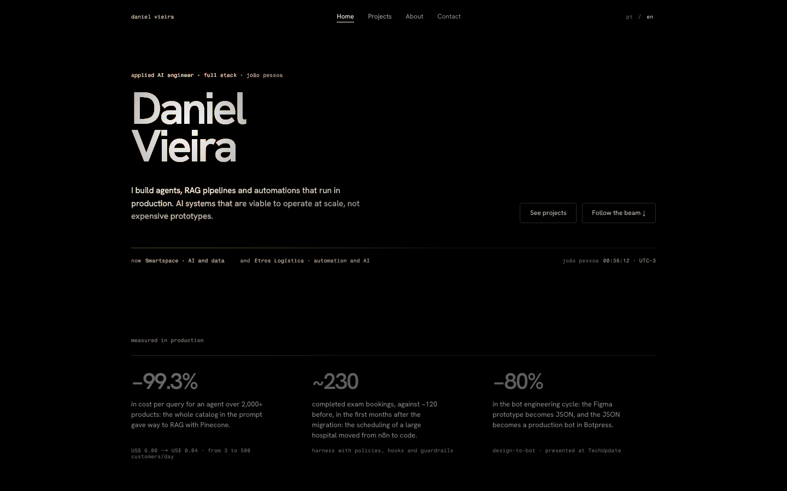
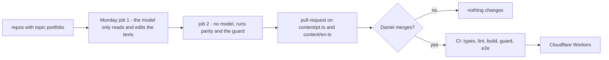
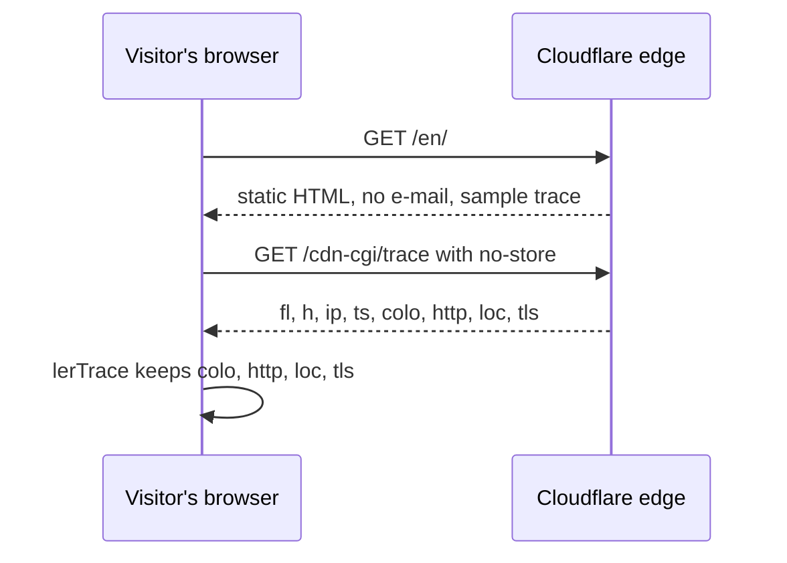

<div align="center">

# portfolio

**Daniel Vieira's portfolio: a black page lit by a flashlight that follows your pointer, in Portuguese and English.**<br />
A client name under NDA or the full e-mail never reach the published HTML: the build fails first.

[](https://github.com/dv-dev1/portfolio/actions/workflows/ci.yml)


[](LICENSE)

[Why](#why) · [See it](#see-it) · [Run it](#run-it) · [How it works](#how-it-works) · [The trap](#the-trap) · [Limits](#what-this-is-not)



**Live:** [daniel-vieira.green-grid.workers.dev](https://daniel-vieira.green-grid.workers.dev)

</div>

---

## Why

A portfolio goes stale the week after it ships, and one that names a client under NDA breaks the NDA in public. Here every open-source project comes from a public repository tagged `portfolio`, a bot proposes changes every Monday as a pull request, and nothing goes live until the content guard and the end-to-end tests pass on `main`.



> The site only says what the repositories and the résumé already say, and the guard checks it on every build.

---

## See it

The guard catching a forbidden word pasted into the About page:

```
$ npm run build && node --test --test-reporter=tap tests/
not ok 2 - nenhuma página publica termo proibido nem sigiloso
  ---
  duration_ms: 73.621458
  type: 'test'
  failureType: 'testCodeFailure'
  error: |-
    Expected values to be strictly deep-equal:
    + actual - expected

    + [
    +   'pt/about/__next.$d$lang.about.__PAGE__.txt: acurácia',
    +   'pt/about/__next._full.txt: acurácia',
    +   'pt/about/index.html: acurácia',
    +   'pt/about/index.txt: acurácia'
    + ]
    - []

  code: 'ERR_ASSERTION'
  name: 'AssertionError'
  expected:
  actual:
    0: 'pt/about/__next.$d$lang.about.__PAGE__.txt: acurácia'
    1: 'pt/about/__next._full.txt: acurácia'
    2: 'pt/about/index.html: acurácia'
    3: 'pt/about/index.txt: acurácia'
# tests 4
# pass 3
# fail 1
```

---

## Run it

```bash
git clone https://github.com/dv-dev1/portfolio && cd portfolio
npm ci
npm run build                              # static site in out/
node --test --test-reporter=tap tests/     # pt/en parity and the content guard
npx playwright install chromium
npx playwright test                        # desktop and an emulated iPhone 13
npm run dev                                # http://localhost:3000/en/
```

Node 26 runs the `.ts` tests directly, with no build step for them.

---

## How it works

| File | Role |
|---|---|
| `app/[lang]/` | builds `/pt/` and `/en/` at build time; pages read the language with `next/root-params` |
| `public/index.html` | sends `/` to `/pt/` or `/en/` by the browser language; without JavaScript, to `/en/` |
| `content/pt.ts`, `content/en.ts` | every text on the site, typed by `Site` |
| `components/Lanterna.tsx` | the flashlight: two radial gradients that follow `--lx` and `--ly` |
| `components/TraceAoVivo.tsx` | reads `/cdn-cgi/trace` in the visitor's browser and keeps four fields |
| `components/Email.tsx` | joins the e-mail address only after hydration |
| `tests/conteudo.test.ts` | scans every `out/**/*.{html,txt}` and the sources `content/pt.ts` and `content/en.ts` for forbidden and NDA terms |
| `.github/workflows/update-portfolio.yml` | the Monday bot: one job where the model only reads, another without the model that validates and opens the pull request |

```ts
// components/TraceAoVivo.tsx
export function lerTrace(texto: string): Trace | null {
  const campo = (k: string) => new RegExp(`^${k}=(.+)$`, "m").exec(texto)?.[1].trim();
  const colo = campo("colo");
  if (!colo || !/^[A-Z]{3}$/.test(colo)) return null;
  return { colo, http: campo("http") || EXEMPLO.http, loc: campo("loc") || EXEMPLO.loc, tls: campo("tls") || EXEMPLO.tls };
}
```

The trace response also carries the visitor's IP; `lerTrace` never reads it, and nothing is stored.



---

## The trap

> [!WARNING]
> A content guard in a public repository cannot list what it protects: `assert(!html.includes("client name"))` publishes the name it hides. The client name, its acronym and a piece of the phone number are stored as SHA-256 hashes, and the guard hashes every word, every pair of words and every 5-digit window of the built pages' visible HTML and of the `content/` sources.

`/cdn-cgi/trace` only exists behind Cloudflare. Locally and in the end-to-end tests the request gets a 404 and the box says "sample"; the tests mock the route to cover the live case.

---

## What this is not

| Not here | Why |
|---|---|
| CMS | content is TypeScript, changed by pull request |
| Analytics, cookies | the trace is read in the browser and never stored |
| More case studies | only agentgraph has one; other projects link to the repo or the live site |
| Phone, WhatsApp, PDF résumé | contact is e-mail, LinkedIn and GitHub |
| Custom domain | lives on workers.dev for now |

---

## License

Code: [MIT](LICENSE). The texts in `content/` describe Daniel Vieira's own work and are © Daniel Vieira.
